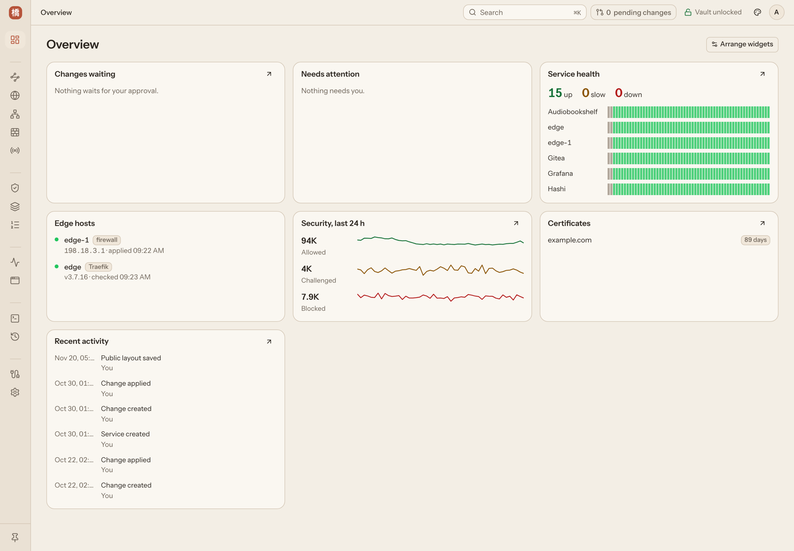
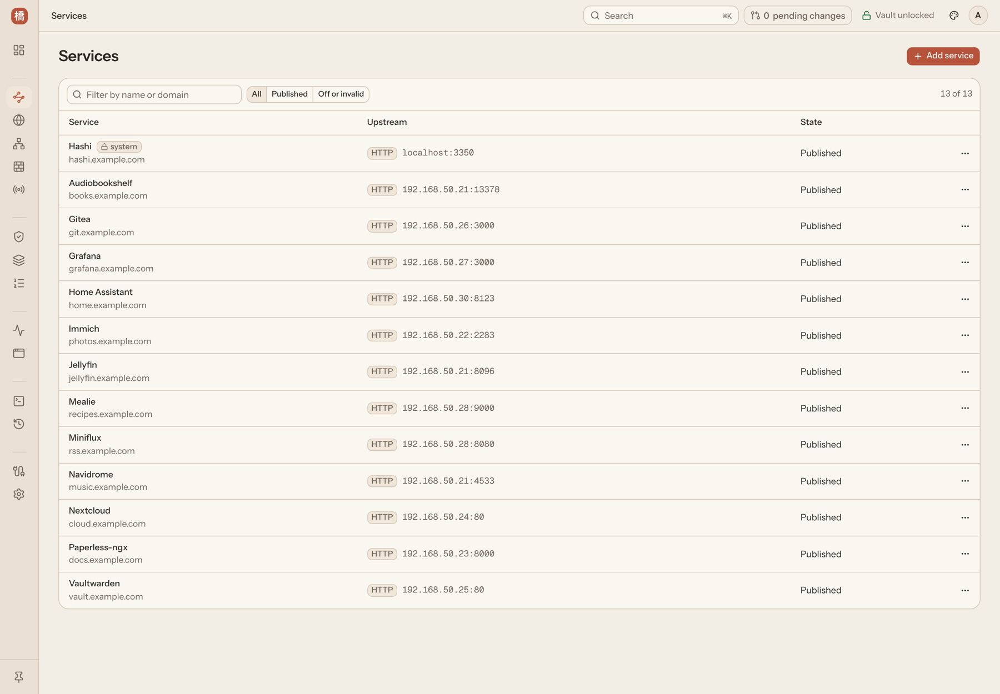
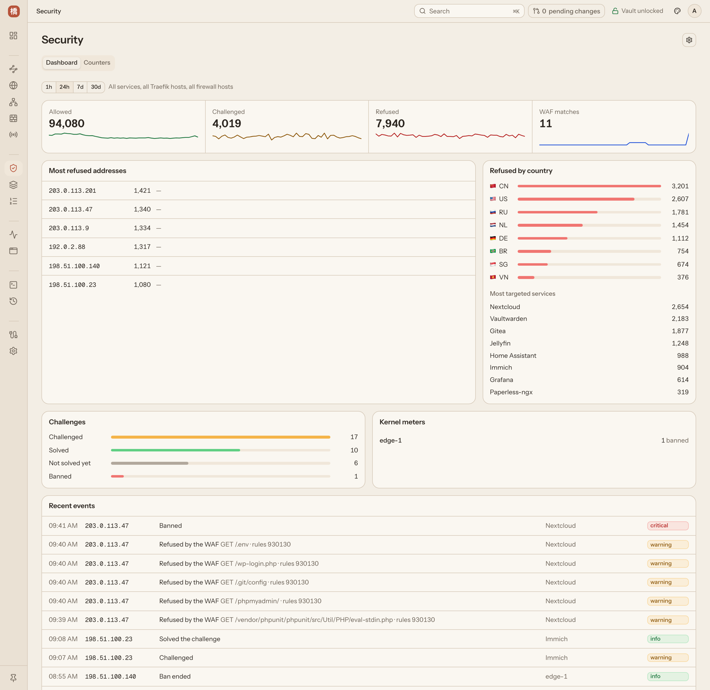
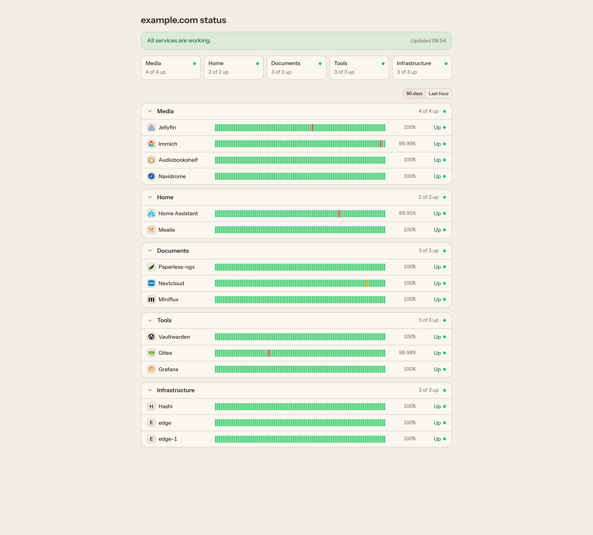
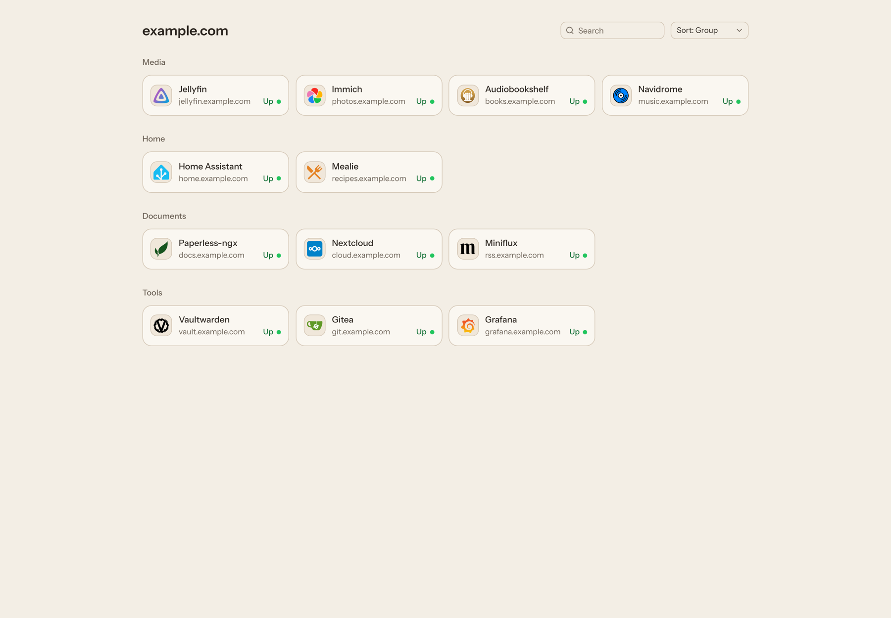

# Hashi (橋)

Hashi manages the edge of a homelab: public DNS, the Traefik reverse proxy, port forwarding on Linux firewall hosts,
internal DNS rewrites, monitoring with public status and app pages, single sign-on and abuse protection. It replaces
hand-edited DNS zones, proxy files and firewall scripts with one admin interface. Every change is shown as a plan and
applied only after approval.

It is meant for a single administrator with a few hosts, for example a rented server with a public address and a
home server behind a router, connected by NetBird. Hashi runs as one container with an embedded SQLite database.



## Features

- DNS records for each service in a Hetzner Cloud DNS zone. Records Hashi didn't create stay untouched unless they
  are imported, and NS and SOA records are never changed.
- Traefik installed and configured on each edge host, with certificates, for HTTP services and plain TCP/UDP ports.
- Port forwarding and filtering in a dedicated nftables table. NetBird keeps working, other programs' rules are left
  alone, and a rescue timer rolls a change back if it cuts off SSH.
- Matching rewrites in AdGuard Home, so service names also resolve inside the network.
- Checks for every service, alerts by mail, Telegram or Discord, a public status page and an app dashboard.
- Single sign-on in front of any service through an OpenID Connect provider, CAPTCHA challenges, IP sets and rule
  sets, blocklist feeds, GeoIP, and rate limits and bans enforced in the kernel.
- Pulse, a small agent that reports changing addresses (such as a home IP) and keeps hosts monitored.
- Scheduled maintenance scripts on the managed hosts, with a log of every run.





The public status page and app dashboard run on their own ports:





## Safety

DNS, Traefik, firewall and AdGuard changes go through a plan that lists the exact effect before anything is written.
After applying, Hashi reads the result back to confirm it. Admin sign-in uses passkeys. Tokens, passwords and SSH keys
are encrypted in a vault, and privileged actions are written to an audit log. The
[threat model](docs/threat-model.md) covers the details.

## Requirements

| Required | |
| --- | --- |
| Docker host | Runs Hashi. Linux on amd64 or arm64. |
| Hetzner Cloud DNS | The only DNS provider so far. |
| Traefik host | At least one Linux host reachable over SSH: Debian, Ubuntu, Fedora or Alpine. Hashi installs Traefik. |
| Firewall host | At least one Linux host reachable over SSH with nftables 1.0 or newer. Can be the Traefik host. |

Optional: AdGuard Home, NetBird, an OpenID Connect provider such as Pocket ID, an SMTP server or a Telegram or
Discord bot for alerts, a MaxMind key for GeoIP, Cap for CAPTCHAs, and Pulse agents on Linux (systemd or OpenRC),
OpenWrt or Docker.

## Installation

On the Docker host, next to [`deploy/compose/compose.yaml`](deploy/compose/compose.yaml):

```bash
mkdir -p data && chown 65532:65532 data && chmod 700 data
docker run --rm git.juzo.io/juzo/hashi:latest keygen > master.key
chown 65532:65532 master.key && chmod 400 master.key
docker compose up -d
```

The setup wizard runs on port 8080. Its first login is printed to `docker logs hashi` and works only from a private
network. The last setup step registers a passkey and shows a recovery key once. Store the recovery key and
`master.key` in a password manager: without them, a database backup can't be opened. Backups, upgrades and recovery
are described in [docs/operations.md](docs/operations.md).

## License

BSD 3-Clause, see [LICENSE](LICENSE).
