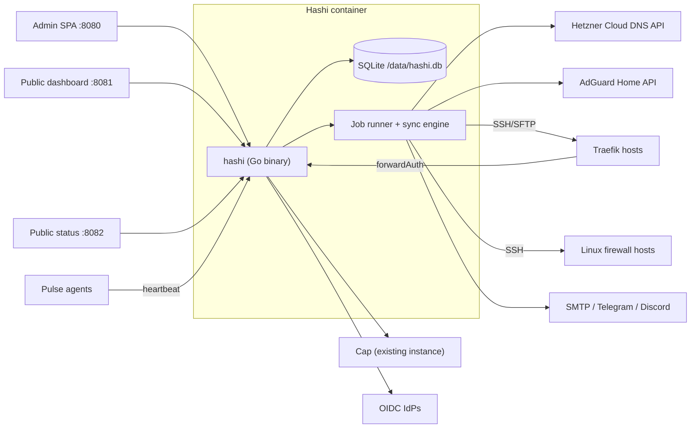

# 01 — Platform: stack, architecture, data, sync engine

## 1. Stack

### Backend — Go

| Concern | Choice |
| --- | --- |
| Language | Go, latest stable, pinned with the `toolchain` directive in `go.mod` |
| HTTP | `net/http` with method/path routing (Go ≥1.22 patterns); no web framework |
| API contract | **Spec-first OpenAPI 3.1** in `api/openapi.yaml`; server interfaces + types generated with `oapi-codegen` (strict server); TS types with `openapi-typescript` + `openapi-fetch` |
| Database | SQLite (WAL mode, `foreign_keys=ON`, `busy_timeout`) via `modernc.org/sqlite` (pure Go → trivial cross-compile, no cgo) |
| Queries | `sqlc` generated from `.sql` files; raw SQL is the norm, no ORM |
| Migrations | `goose` with embedded SQL migrations; forward-only in production; each migration tested on a copy of the previous schema with fixture data |
| WebAuthn | `github.com/go-webauthn/webauthn` |
| OIDC (upstream IdPs) | `github.com/coreos/go-oidc/v3` + `golang.org/x/oauth2` |
| SSH/SFTP | `golang.org/x/crypto/ssh` + `github.com/pkg/sftp`; host-key pinning mandatory |
| DNS queries (checks, resolution) | `github.com/miekg/dns` |
| YAML | `go.yaml.in/yaml/v3` (strict decoding with `KnownFields`) |
| GeoIP | `github.com/oschwald/maxminddb-golang/v2` |
| Cron parsing | `github.com/robfig/cron/v3` (parser only; scheduling is Hashi's own job runner) |
| Crypto | stdlib `crypto/aes`+`cipher` (AES-256-GCM), `crypto/hkdf`, `golang.org/x/crypto/argon2` (argon2id) |
| Logging | `log/slog` JSON handler wrapped by a redacting handler (allow-listed attribute keys; secret-typed values render as `[redacted]`) |
| Lint/format | `gofmt`, `go vet`, `staticcheck`, `golangci-lint` (pinned config) |

**Changed from V2:** .NET 10 + EF Core + PostgreSQL 18 → Go + sqlc + SQLite. Reasons: one backend language shared with
the Pulse agent (2 languages instead of 3), one static binary and one container instead of two, no DB server to
operate or upgrade (V2's first install blocker was a Postgres 18 volume path), and homelab scale (single user,
< 1k services, minute-bucketed telemetry) is far inside SQLite's comfort zone. PostgreSQL partitioning is replaced by
time-bucketed tables with batched retention deletes (§4.3).

### Frontend — SvelteKit SPA

- Svelte 5 (runes) + SvelteKit 2 with `adapter-static` (SPA fallback); built assets embedded in the Go binary via `embed`.
- TypeScript strict. Component system: **shadcn-svelte on Bits UI** — the only component system.
- Tailwind CSS v4 with Hashi semantic tokens (10-ui.md); `tailwind-variants`, `clsx`, `tailwind-merge`.
- Icons: Lucide (`@lucide/svelte`). Charts: uPlot (+ plain SVG for strips/sparklines). Editors: CodeMirror 6 (YAML, shell).
- Forms: typed forms validated with Zod schemas derived from the OpenAPI types where practical.
- Tests: Vitest + Testing Library; Playwright for E2E and visual tests.
- Package manager: pnpm (pinned via `packageManager`).

**Changed from V2:** "SvelteKit 5" in V2 was a naming error — the versions are Svelte 5 / SvelteKit 2.

### Pulse agent — Go

Same module repository (`agents/pulse`), static binary, distroless/scratch image < 10 MB. See 08-pulse.md.

## 2. Architecture



Hashi is the control plane; Traefik and firewall hosts are the data plane. The database holds desired state,
observed state, sync plans, audit history, monitoring samples, security telemetry and encrypted secrets.

One process serves three listeners (admin+API, public apps, public status), runs the job runner, monitor
workers and forward-auth endpoint. The forward-auth path must not depend on the job runner: it reads in-memory
caches refreshed from the DB and degrades as specified in 06-edge-security.md if the DB is slow.

### Ports and paths

| Listener | Default | Content |
| --- | --- | --- |
| Admin | `8080` | SPA, `/api/*`, `/api/edge-auth/*`, `/api/edge-challenge/*`, `/api/pulse/*/heartbeat`, `/healthz`, `/readyz` |
| Public dashboard | `8081` | App dashboard at `/`, `/api/public/apps` |
| Public status | `8082` | Status page at `/`, `/api/public/status` |

All configurable; public listeners can be disabled. Edge, challenge and Pulse endpoints are on the admin listener but
use their own auth models and are routed through separate middleware stacks (no admin cookie accepted, no CSRF
token required, separate rate limits).

## 3. Repository layout

```text
hashi/
  CLAUDE.md                 agent instructions (short)
  .claude/                  skills, hooks, settings (committed)
  Makefile                  the only entry point for build/check/test/deploy
  go.mod
  api/openapi.yaml          source of truth for the HTTP API
  cmd/hashi/                main
  internal/
    app/                    wiring, config, listeners
    httpapi/                generated server + handlers per feature
    store/                  sqlc queries, migrations, retention
    secrets/                vault, envelope crypto, redaction types
    auth/                   bootstrap, passkeys, admin sessions, scopes
    setup/                  setup state machine
    sync/                   plan/apply/verify engine, locks, risk
    jobs/                   job runner, schedules
    dns/                    provider interface, hetzner/, planner
    adguard/
    traefik/                renderer, installer, validator
    services/
    ipsets/                 IP set + item types, cycle check, the one compiler, reactivity (05a)
    rules/                  rule sets, flatten, evaluate, trace (06 §4)
    firewall/               folding, nftables renderer, host link, rescue, netbird
    edge/                   forward auth: Stage A engine, Stage B via rules, sso, captcha
    security/               dynamic entries, ban counters, feeds, telemetry, geoip, log tail
    monitor/                checks, rollups, events
    notify/                 smtp, telegram, discord, routing
    pulse/                  server-side agent model
    scripts/
    sshx/                   SSH/SFTP client with host-key pinning, atomic write
  web/                      SvelteKit SPA
  agents/pulse/             Pulse agent (own go module)
  deploy/                   compose files, example env, Traefik/firewall templates
  testdata/contracts/       recorded, sanitized real API responses (see 11-delivery.md)
  docs/spec/                this specification
  docs/adr/                 architecture decisions
  docs/progress.md          slice status + prod-proof log
  legacy/v1/                V1 (Node) — runs production until cutover, then deleted
  .gitea/workflows/
```

## 4. Data store

### 4.1 Conventions

- One SQLite file at `/data/hashi.db`; WAL; single writer connection + read pool.
- IDs: ULIDs as text (sortable, URL-safe). Timestamps: integer Unix milliseconds UTC, column suffix `_at`.
- Provider-specific settings: `settings_json` TEXT validated against a Go struct on read and write.
- Secrets never stored in clear: columns reference `secret_records.id`.
- Every mutating admin action writes an `audit_events` row in the same transaction.

### 4.2 Tables (outline)

Core: `app_settings`, `setup_state`, `audit_events`, `connections` (target = address set), `connection_health`,
`secret_records`, `sync_plans`, `sync_plan_items`, `sync_runs`, `jobs`, `job_runs`.

Auth: `admin_users` (exactly one), `passkey_credentials`, `admin_sessions`, `recovery_key` (hash + wrapped material).

Services: `services`, `service_routes`, `service_targets` (address sets), `service_middlewares`, `service_ports`,
`service_waf_modes`.

IP sets and rule sets (shared primitives, object model in 06a §0): `ip_sets`, `ip_set_elements`, `ip_set_feeds`,
`ip_set_feed_runs`, `dynamic_entry_state`, `dynamic_entry_hosts`, `address_counters`, `rule_sets`, `rule_entries`; view
`ip_set_consumers`.

DNS: `dns_zones`, `dns_records` (desired), `dns_observed_rrsets`, `dns_ownership`, `dns_import_decisions`.

AdGuard: `adguard_rewrites_owned`.

Traefik: `traefik_hosts`, `traefik_files` (path, last hash, last applied), `traefik_user_middlewares`, `traefik_entrypoints`.

Firewall: `firewall_hosts`, `firewall_subnets`, `firewall_netbird`, `firewall_ports`, `firewall_bindings`,
`firewall_host_access`, `firewall_host_sets`, `firewall_host_link`.

Edge/security: `oidc_providers`, `edge_sessions`, `security_events`, `security_buckets_1m`, `security_ip_top_1m`,
`geoip_databases`, `captcha_settings`, `challenge_attempts`.

Monitoring: `monitor_endpoints`, `monitor_checks`, `monitor_samples` (raw), `monitor_rollups` (bucket_size ∈ 60/300/3600),
`monitor_events`, `notification_providers`, `notification_routes`, `notification_deliveries`.

Pulse: `pulse_agents`, `pulse_tokens` (hash only), `pulse_heartbeats` (recent only).

Scripts: `host_scripts`, `host_script_targets`, `host_script_env`, `host_script_runs`.

Area files define the fields that matter for behaviour; the migration files are the authoritative schema.

Every connection has: ID, name, type, enabled flag, health state (`unknown` / `validating` / `healthy` / `degraded` /
`failed`), last validation result + timestamp, encrypted secret references, typed provider settings, and a deletion
policy (`required` / `optional` / `system_linked` / `safe_to_remove`) enforcing invariant 11.

Volumes: `/data` (DB, backups, GeoIP, assets, uploads, rendered plans, cache) is required; `/logs` is optional for file
logging in addition to stdout.

### 4.3 Telemetry volume and retention

| Data | Granularity | Default retention |
| --- | --- | --- |
| Monitor raw samples | per check | 30 days |
| Monitor rollups 1 m / 5 m / 1 h | bucket | 90 d / 180 d / 2 y |
| Security buckets | 1 minute | 30 days (then 1 h rollup 1 y) |
| Security events | per event | 90 days |
| Audit events | per event | 2 years |
| Pulse heartbeats | per heartbeat | 7 days |

Retention runs as a job deleting in batches of ≤ 5,000 rows per transaction so it never blocks the writer.

Security telemetry is also bounded by **volume**, not only by age, because one scan can produce millions of distinct
IP × path combinations (details in 06-edge-security.md §6.1):

- Stored security buckets have no IP and no full path; per-IP counters live only in memory for decisions.
- Events are stored only for non-allow decisions, capped per address per minute; the rest is a counter.
- Writes are batched (at most one flush per second).
- Database size budget (setting, default 2 GB): a warning at 80 %; above 100 % retention deletes the oldest security
  buckets and events first, regardless of age. Audit events are never deleted by the size budget.
Rollups are computed from **closed** buckets only.

## 5. Sync engine

All external state changes flow through one engine.

### 5.1 Lifecycle

1. **Plan** — load desired state, fetch observed state from the provider, normalize both, diff, classify each item's risk,
   render any files in memory, validate them (locally and, for Traefik, remotely in dry-run). Persist plan + items.
2. **Approve** — low-risk plans auto-approve (on save and in background runs); high-risk plans wait for an admin with
   `sync.apply` (and `firewall.apply` where relevant) plus recent reauth. The approval screen shows exact values
   (record values, TTLs, file diffs, rule diffs) — the applied plan must be byte-for-byte the previewed plan.
3. **Apply** — acquire the per-connection lock (one global lock table, used by *every* apply path, including single-subsystem
   applies). Re-fetch observed state; if it changed since planning, re-plan and, if the new plan differs in
   any high-risk item, return to Approve. Apply items in dependency order.
4. **Verify** — read back observed state, confirm it matches desired, store `last_applied_hash`, write the run result and
   audit entry, enqueue dependent syncs (e.g. DNS change → monitor endpoint refresh).

### 5.2 Risk levels

| Risk | Examples | Default |
| --- | --- | --- |
| Low | create/update Hashi-owned record, rewrite Hashi Traefik dynamic file, update folded `allow`/`block`/`host_access` elements | auto-apply |
| High | delete any record, prune imported records, open a new public port, close a port, change static Traefik config, first firewall apply, a new block of /16 (IPv6 /32) or larger, removing an allowed range that contains the admin's session address or a rescue source, structural firewall change on a host whose rescue path is NetBird (05-firewall.md §4.4) | approval |
| Not a plan | engine-made dynamic set entries (bans, unbans, staging drain) — security events via the host link (invariant 7) | immediate |
| Forbidden | NS/SOA change, touching unowned objects, flushing foreign chains | never planned |

### 5.3 Subsystem order for a global sync

`dns-zones → dns-records → traefik (static, then dynamic) → firewall → adguard → monitor-endpoints`. A failure in one
connection marks that connection's plan failed and continues with independent connections; dependents of the failed
item are skipped with reason `dependency_failed`.

### 5.4 Triggers

- Immediate plan after a save that affects a subsystem (debounced 2 s).
- Periodic global reconcile, default every hour (setting).
- Manual "Sync now" per subsystem and global.
- IP set recompile (Pulse address change, host IP change, DNS item refresh, feed update, GeoIP update, item expiry,
  set edit) → the consumers' syncs (05a §4.2); monitor configuration change.

## 6. Job runner

- Jobs are rows in `jobs` (kind, schedule, enabled) with runs in `job_runs` (started, finished, status, duration, summary, error).
- In-process scheduler; one goroutine per due job kind; a kind never overlaps itself.
- Every job is visible in the UI (Activity → Jobs) with last run, next run, status, duration, diff summary and error (invariant 15).
- Jobs that need secrets get them from the service vault (02-setup-auth.md §5). If the vault cannot unlock, those jobs
  pause with a critical health warning; secret-free jobs (monitoring without auth, retention) continue.

## 7. API conventions

- JSON over HTTPS; errors use RFC 9457 problem details with a stable `type` URI per error kind.
- Admin endpoints: session cookie + CSRF header (double-submit token bound to the session) on unsafe methods.
- Each admin operation declares its required scope(s) in the OpenAPI spec (`x-hashi-scopes`) and, where applicable,
  `x-hashi-reauth: true`. A generated middleware table enforces both; an endpoint without a declared scope fails CI.
- Pagination: cursor-based (`?cursor=&limit=`), `limit` ≤ 500.
- Long operations (plan, apply, script run) return `202` with a run ID; progress via polling or SSE `/api/events`.
- The OpenAPI document is the contract: handlers are generated from it, the frontend client is generated from it, and CI
  fails if generated code is stale (`make generate && git diff --exit-code`).

### Endpoint groups

Admin: `/api/setup/*`, `/api/auth/*` (passkeys, session, sessions, reauth), `/api/vault/*`, `/api/connections/*`,
`/api/services/*`, `/api/dns/*`, `/api/traefik/*`, `/api/firewall/*`, `/api/adguard/*`, `/api/pulse/*`, `/api/status/*`,
`/api/dashboard/*`, `/api/security/*`, `/api/scripts/*`, `/api/settings/*`, `/api/sync/*`, `/api/activity/*`, `/api/events`.

Edge: `/api/edge-auth/forward`, `/api/edge-auth/login`, `/api/edge-auth/callback`, `/api/edge-auth/logout`,
`/api/edge-challenge/start`, `/api/edge-challenge/verify`, `/api/edge-challenge/status`.

Public: `/api/public/apps`, `/api/public/status`.

Agent: `POST /api/pulse/{agentId}/heartbeat`.

Area files list the detailed endpoints.

## 8. Client IP resolution (shared)

One resolver is used everywhere a client IP matters (bootstrap restriction, admin session binding, forward auth, rate
limiting, Pulse public IP):

- Trusted-proxy CIDR list (setting; high-risk to change). Forwarding headers (`X-Forwarded-For`, `X-Real-IP`, `Forwarded`)
  are honoured only when the direct peer is trusted; the chain is walked right-to-left, skipping trusted hops.
- IPv4-mapped IPv6 normalized to IPv4; zones stripped; result canonicalized.
- Unparseable → fail closed.
- For forward auth, Traefik passes the original client IP in `X-Forwarded-For`; Traefik hosts' internal IPs are
  automatically part of the trusted-proxy list.
