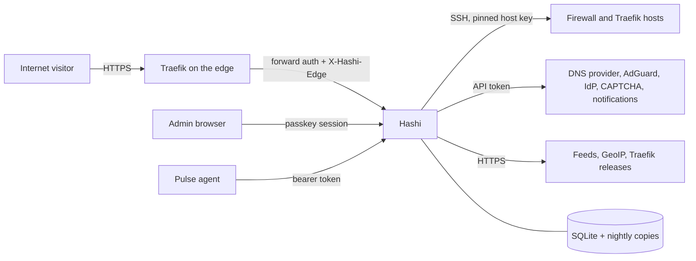

# Threat model

What Hashi protects, from whom, where the trust boundaries are, which control stops which threat, and the risks we
accept. Written for 1.0 (S12, 2026-11-12). Update it when a new boundary, secret or external system appears, and
when a scan finding is accepted. The controls are specified in `docs/spec/`; this file only points at them.

## 1. What Hashi is, seen from an attacker

One container (Go binary, SQLite, embedded SPA) that holds the keys to a homelab's edge: it writes public DNS, renders
Traefik's configuration, applies nftables rules as root on firewall hosts over SSH, runs root scripts there, answers
every forward-auth request, and receives Pulse heartbeats. **Whoever controls Hashi controls DNS, the reverse proxies
and the firewalls.** Everything below follows from that.

Single admin, single installation, self-hosted. No multi-tenant isolation is attempted.

## 2. Assets

| Asset | Where it lives | Why it matters |
| --- | --- | --- |
| Master key | Deployment secret (service mode) or nowhere on disk (strict mode) | Opens every stored secret |
| Recovery key | The admin's password manager; a wrapped copy of the master key in the DB | Recovers the master key |
| SSH key for firewall and Traefik hosts | Vault (service class) | Root on those hosts |
| DNS provider token | Vault | Changes every record in the provider project (NS/SOA excepted by invariant 2) |
| AdGuard, notification, OIDC, CAPTCHA, MaxMind credentials, script secrets | Vault | Each opens its own system |
| Admin passkeys and sessions | DB (public keys; sha256 of session ids) | Admin access |
| Edge token, edge session key, operational keys | Vault; in strict mode also `vault_kept` | Trust in forwarded addresses; edge sign-ins; CSRF; Pulse token check; CAPTCHA clearances |
| Pulse agent tokens | Agent hosts; HMAC with a pepper in the DB | An agent's reported address feeds DNS, services and firewall sets |
| Pulse signing key | CI secret; private half offline | What every agent installs on self-update (ADR 0003) |
| Desired state, audit log, telemetry | DB and nightly copies | Integrity of the edge; evidence after an incident |

## 3. Who might attack

| Actor | Reach | Goal |
| --- | --- | --- |
| Internet visitor | Public names through the edge; public status and dashboard pages | Reach protected apps, abuse them, take the edge down |
| Someone on the home or VPS network | The admin listener, Pulse endpoint, bootstrap login (private networks only) | Admin access, fake agent reports |
| Stolen disk, LXC backup or DB copy | Files only | Read secrets, forge sessions |
| Compromised managed host (firewall or Traefik host) | Its own SSH session from Hashi, its Traefik logs, its Pulse agent | Move to Hashi or to other hosts |
| Compromised Pulse agent | Its own token | Report a false address so DNS, upstreams or allow sets point at the attacker |
| Compromised upstream source | Feeds, GeoIP, Traefik releases, Go/npm dependencies, base images | Supply chain into Hashi or the hosts |
| Malicious repository change | CI, the release job | A poisoned image or agent build |

Out of scope: an attacker who already has root on the Hashi host, the admin's unlocked device, or the admin's
password manager. Hashi can't defend against those and does not try.

## 4. Trust boundaries

B1 visitor → edge → Hashi · B2 admin browser → Hashi · B3 Pulse agent → Hashi · B4 Hashi → managed hosts ·
B5 Hashi → provider APIs · B6 downloads into Hashi · B7 data at rest · B8 source → CI → image and agent.

## 5. Threats and controls

Each row: the threat, what stops it, and where that is specified or tested. "Test" names a test or the e2e flow.

### B1 Visitor → edge → Hashi

| Threat | Control | Where |
| --- | --- | --- |
| Reach a protected app without signing in | Forward auth on every router; rule sets, first match wins; deny fallback | 06 §2–4, invariant 22 |
| Spoof `X-Forwarded-For` to look like an allowed address | Forwarding headers trusted only from trusted proxies or with the edge token; Traefik overwrites the token header | 01 §8, `TestUntrustedForwardingHeadersAreIgnored` |
| Send a fake user header to the upstream | Client-sent identity headers removed before forwarding | 06 §7, S9 gate |
| Flood or scan | Stage A: rate window, WAF score, CAPTCHA challenge, escalation to a kernel ban; feeds in `dyn` sets | 06 §3, 05 §6 |
| Get the admin's own address banned | A manual allow outranks every dynamic decision | invariant 20 |
| Hashi down → protected apps open | Fail closed: rule-bearing services answer 503 while Hashi is unreachable | 06 §2.1, S9 gate |
| Learn internal addresses from public pages | Public status lists name, group, state and uptime only; alert text strips raw errors | 07, S7 gate |

### B2 Admin browser → Hashi

| Threat | Control | Where |
| --- | --- | --- |
| Phish or guess the admin login | Passkeys only (RP ID = root domain, origin = admin domain); bootstrap login only before setup, from private networks, argon2id | 02 §1.1, §2 |
| Steal a session cookie | HttpOnly, Secure, SameSite=Strict; session bound to the client address; idle and absolute expiry | 02 §3, S1 gate |
| CSRF | Token required on every unsafe method | 02 §4, `TestCSRFRequiredOnUnsafeMethods` |
| A stolen but live session does damage | Fresh passkey (5 min) for root-capable and high-risk actions: scripts, secrets, vault mode, passkeys, trusted proxies | 02 §3.3, invariant 17 |
| Change edge state without seeing it | Every Traefik, firewall, DNS and AdGuard change is a plan with a preview and an audit entry | invariant 7 |
| Lock the admin out | Rescue timer on firewall applies; `hashi admin recover` from the console | 05 §7, 02 §2 |

### B3 Pulse agent → Hashi

| Threat | Control | Where |
| --- | --- | --- |
| Forge an agent's heartbeat | Per-agent random token, stored as HMAC with a pepper; unknown id and wrong token answer the same | 08 §3 |
| A real agent reports a false public address | The connection's source address wins; a reported address only for agents the admin trusts for it | 08 §2 |
| Hammer the endpoint | Minimum gap between beats, 429 | 08 §3 |
| Push a malicious agent update | Ed25519-signed releases; the agent checks signature, version and architecture | ADR 0003 |

### B4 Hashi → managed hosts

| Threat | Control | Where |
| --- | --- | --- |
| Man in the middle on SSH | Host key pinned at setup, refused on change | 04 §5, 05 §2 |
| Break a host's foreign rules | Only `table inet hashi`; never flush; NetBird and Docker untouched | invariant 12, 05 §5 |
| Cut off access with a bad rule set | Apply under a rescue timer that rolls back without confirmation | 05 §7 |
| Shell injection through user input | Renderers marshal structs; script variables passed as base64 data, never evaluated | CLAUDE.md "Code", 09 §1 |
| A compromised host attacks Hashi | Hashi only reads files and command output it asked for; access logs are parsed, never executed | 06 §6.2 |

### B5 Hashi → provider APIs

| Threat | Control | Where |
| --- | --- | --- |
| Delete the zone's delegation | NS and SOA never touched | invariant 2 |
| Change records Hashi doesn't own | Ownership in the DB; imported records stay `leave` until assigned | invariant 1 |
| Write after a failed read check | No write when validation fails | invariant 3 |

### B6 Downloads into Hashi and the hosts

| Threat | Control | Where |
| --- | --- | --- |
| Poisoned Traefik binary | Release checksum checked before install | 04 §2 |
| Poisoned feed | Feeds are data: parsed as address lists, capped, never executed | 06 §8 |
| Vulnerable dependency | Pinned modules and lockfile; scans in CI (§7) | 11 §2 |

### B7 Data at rest

| Threat | Control | Where |
| --- | --- | --- |
| Read secrets from a DB copy or backup | Envelope encryption, AES-256-GCM, per-secret key; the master key is not in the DB | 02 §5.2, invariant 5 |
| Read secrets from the whole disk (key file included) | Strict mode: the master key is not on disk | 02 §5.4 |
| Secrets in logs | `secrets.Value` renders `[redacted]`; redacting log handler | invariant 5, `TestInvariant_5_*` |
| Lose everything | Nightly copies, 14 kept; restore with the recovery key | 11 §8 |

### B8 Source → CI → image

| Threat | Control | Where |
| --- | --- | --- |
| Secrets committed to the public repo | Secret guard in pre-commit and pre-push hooks with a private deny list | invariant 19, CLAUDE.md "Safety" |
| Image tampered with after build | Built and pushed by CI only; distroless, runs as uid 65532 with a read-only root | 11 §2, S0 gate |

## 6. Accepted risks

Each one is a decision, not an oversight. Reopen one when its reason no longer holds.

1. **Hashi is a single point of control.** A full compromise of Hashi gives DNS, edge and root on managed hosts. The
   controls above make that hard; no design removes it short of splitting the product.
2. **Service mode keeps the master key on the same host as the DB.** Root on that host, or its full disk, opens
   every secret. Strict mode exists for those who need more; the owner runs service mode so that nothing stops after a
   restart (decision 2026-11-11).
3. **Strict mode keeps a few keys in the clear** (`vault_kept`): operational keys, the edge session key and the edge
   token. A stolen disk could forge an edge session, a CAPTCHA clearance or a trusted forwarded address, but opens no
   stored secret. The price of "no automation breaks while locked" (02 §5.4).
4. **While locked, bans don't reach firewall hosts** and Traefik access logs aren't read: both need the SSH key.
   Forward auth still blocks banned addresses at the edge.
5. **No login rate limit on the admin endpoints.** There is nothing to guess: passkeys, and a 24-character random bootstrap
   password (about 140 bits) that exists only before setup and only from private networks. Stage A still rate-limits through the edge.
6. **The DNS token is project-wide.** The provider offers no narrower token; invariants 1–3 limit what Hashi does
   with it.
7. **The Pulse signing key's holders can sign agents.** Whoever can run the release job can already change the
   release (ADR 0003).
8. **Scripts are root on firewall hosts by design** (09 §1): reauth, audit and line diffs, no sandbox.
9. **A visitor's address can be wrong behind someone else's proxy.** Only proxies the admin trusts are believed; an
   untrusted proxy makes its visitors look like one address (fails towards blocking, not towards allowing).

## 7. Scans

A finding is fixed or added here with its reason.

`make scan` runs the first two; CI runs it on every push, the release job scans both pushed images.

| Scan | What it covers | Result (2026-11-12) |
| --- | --- | --- |
| `golangci-lint` with `gosec` | Go code patterns (injection, weak crypto, file modes) | clean (`make check`) |
| `govulncheck` (pinned in `tools/go.mod`) | Go modules and the standard library, reachable code first | clean after Go 1.27.4 (net/http server crash, GO-2026-6859, reachable), `golang.org/x/net` 0.62.0, `golang.org/x/crypto` update |
| `pnpm audit --prod` | Web packages that end up in the shipped SPA | clean |
| Trivy 0.76.1, image | Debian base packages and the Go binary in the image | base clean; binary: go-jose 4.1.4 (DoS through crafted JWKs, from the IdP) and x/net, both updated |

Accepted (build tools only, never shipped; `pnpm audit` without `--prod`):

| Package | Finding | Why accepted |
| --- | --- | --- |
| `@sveltejs/kit` < 3 | Redirect via enhanced forms; XSS via cache-control in prerendered pages | The SPA is static (adapter-static): no form actions, no server, no prerender headers. Kit 3 was deferred in S0 |
| `cookie` < 0.7 | Out-of-range characters in cookie names | Kit's server side only; nothing runs it |
| `minimatch` < 11.0.1 | DoS through glob patterns | Build-time globs written by us |
| `deepmerge` ≤ 4.3.1 | Prototype poisoning | Build-time config merge in the Svelte plugin; no fix exists |

## 8. Deployment advice that follows from this

- Keep the master key and the recovery key in a password manager, not next to the backups.
- Don't give CI jobs the Docker socket of the host that runs Hashi: a job could then reach Hashi's container and data.
- Expose the admin name publicly only behind a rule set that limits who reaches it (the admin service's root rule set).
- Copy `/data/backups` off the host (the host's own backup is fine); the copies are useless without a key.
